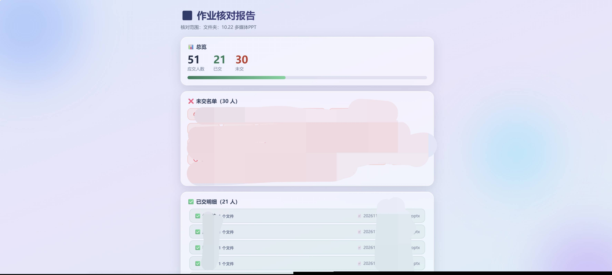
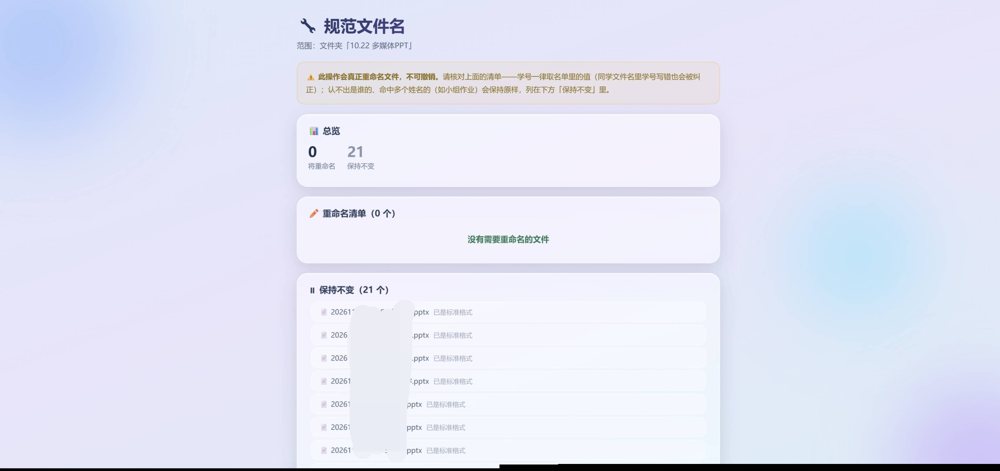

# 作业收集箱 · Homework Dropbox

一个**免账号、盲传式**的作业收集网站。同学打开网页、选文件夹、拖文件上传；系统按内置名单自动识别是谁交的，把文件名规范化为「学号 姓名」；管理员在管理页一键核对谁没交、按文件夹打包下载。

- 技术栈：Python 3 + Flask，**单个 `.py` 文件**，无数据库、无前端构建
- 数据全在本地目录（`uploads/` + 几个点文件），拷贝即迁移
- 自带液态玻璃风格 UI，桌面端 / 手机端都可用
- 跨平台：Windows / macOS / Linux 均可直接运行


---

## 功能特性

**同学端（上传页）**
- 顶部显示管理员发布的公告（截止提醒、命名要求等）
- 点击 / 拖拽多选，多个文件并行上传，每个文件独立进度条 + 总体进度；网络中断自动重试（最多 2 次）
- 上传前校验：拦截可执行文件；单文件大小与单次文件数量上限可在管理端调整
- **小文件确认**：≤ 1KB 的文件弹窗提醒「可能没传对」，确认后才传
- **重复提交确认**：该文件夹里已有同名文件（**不看后缀、忽略大小写**）或识别为同一同学时，弹窗「替换原文件 / 取消」，绝不悄悄留两份
- 必须选择文件夹才能上传（不提供"未分类"），服务端同步拦截
- 手机端一个入口即可，`accept` 同时包含文档与图片/视频，安卓/桌面浏览器都能唤出「文件」

**管理端（管理页，顶部 TAB 切换）**
- 文件管理：按文件夹筛选、文件列表、单文件下载 / 删除
- 上传文件：与同学端同一套上传面板（管理员代传用），**管理端不做大小与数量限制**
- 文件夹管理：新建 / 重命名（不动里面的文件）/ 删除（连同文件，两步确认）
- 公告栏：编辑发布 / 更新 / 撤下，立即生效在同学上传页顶部
- 批量下载：按文件夹打包 ZIP（选"全部文件夹"时保留目录结构）
- 应交名单：粘贴导入「姓名 + 学号」，分隔符不限
- 作业核对：自动算应交 / 已交 / 未交，列未交名单、已交明细、无法识别的文件；**核对页有独立的文件夹选择，只允许选具体文件夹**（避免把同一人在不同作业里的提交算成重复）
- 规范文件名：先出「原名 → 标准名」预览清单，确认后才批量执行
- 上传设置：「名单识别」开关、「自动规范化」开关、命名模板、客户端上传上限

**自动规范化（可开关、模板可自定义）**
- 上传后识别文件名里的身份（先精确后子串，必须唯一命中）
- 学号一律取名单里的值——同学把学号写错也会被纠正
- 命名格式随意都认：`学号姓名`、`学号 姓名`、`学号+姓名`、`学号_姓名`、`姓名 学号`、`姓名(1)` 等
- 2 字 / 3 字 / 4 字（复姓、双姓）姓名无差别处理
- 认不出是谁、命中多个姓名（如小组作业）→ 保持原样并在核对页标出，不猜

**安全设计**
- 盲传原则：上传页没有任何文件列表 / 下载接口，同学看不到别人的文件
- 管理页全部接口需令牌（`.admin_token`），无令牌 / 错令牌一律 401
- 同人不允许并存两份：替换是"按人 + 按同名"清理旧文件，不会越积越多

---

## 界面截图

### 管理页（文件管理 TAB）

文件夹筛选与管理、按文件夹批量下载、作业核对入口、文件列表：


### 作业核对报告

应交 / 已交 / 未交总览与进度条、未交名单、已交明细：



### 规范文件名

先出「原名 → 标准名」预览，确认后才执行；认不出的列在"保持不变"并注明原因：



### 应交名单

粘贴「姓名 学号」配对即可（每行一个，分隔符不限）；只有姓名没有学号时自动重命名不启用，核对功能不受影响：


---

## 环境要求

| 依赖 | 说明 |
|---|---|
| Python 3.8+ | 实测 3.9 / 3.12 / 3.13 均可 |
| Flask | `pip install -r requirements.txt` |
| openssl（**可选**） | 有则首次启动自动生成自签名证书；没有则自动以 HTTP 启动 |

不需要数据库、Node、Nginx 等任何额外组件。

---

## 快速开始

```bash
git clone https://github.com/LYJ2025/homework-dropbox.git
cd homework-dropbox

# 建议用虚拟环境（可选）
python3 -m venv .venv
source .venv/bin/activate        # Windows: .venv\Scripts\activate

pip install -r requirements.txt
python upload_server.py          # Windows 下可能是 python，或 py -3
```

启动后会打印类似信息，**管理令牌以实际输出为准**：

```
==========================================================
  作业收集箱已启动：https://localhost:8080/
  管理页：https://localhost:8080/admin?token=<令牌>
  数据目录：/path/to/homework-dropbox
  管理令牌：/path/to/homework-dropbox/.admin_token
==========================================================
```

| 页面 | 地址 |
|---|---|
| 同学上传页 | `https://localhost:8080/` |
| 管理页 | `https://localhost:8080/admin?token=<令牌>` |

- 自签名证书浏览器会提示不安全，点「高级 → 继续访问」即可（内网 / 测试用；公网请用正式证书）
- 令牌也可随时从数据目录的 `.admin_token` 读取
- 局域网内同学访问：把 `localhost` 换成你机器的内网 IP，并确认防火墙放行端口

---

## 配置

**全部可用命令行参数或环境变量指定，不需要改代码。**

| 命令行 | 环境变量 | 默认值 | 说明 |
|---|---|---|---|
| `--host` | `HOST` | `0.0.0.0` | 监听地址；只想本机访问填 `127.0.0.1` |
| `--port` | `PORT` | `8080` | 监听端口 |
| `--cert` | `CERT_FILE` | `<数据目录>/cert.pem` | 证书路径（PEM） |
| `--key` | `KEY_FILE` | `<数据目录>/key.pem` | 私钥路径（PEM） |
| `--http` | `HTTPS=0` | —— | 以 HTTP 启动，不使用 / 不生成证书 |
| —— | `DATA_DIR` | 脚本所在目录 | 数据目录：`uploads/`、名单、令牌、证书都放这里 |

```bash
# 换端口 + 只允许本机
python upload_server.py --port 9000 --host 127.0.0.1

# 环境变量方式（macOS / Linux）
PORT=9000 DATA_DIR=/srv/homework python upload_server.py

# Windows PowerShell
$env:PORT=9000; $env:DATA_DIR="D:\homework"; python upload_server.py
```

`DATA_DIR` 的用处：把代码放只读目录 / 容器里跑、或把数据放到独立磁盘。**迁移到新机器只需拷走数据目录**。

---

## 数据文件（都在 `DATA_DIR`）

| 路径 | 说明 |
|---|---|
| `uploads/` | 作业文件；子目录即文件夹，直接放根目录的算「未分类」 |
| `.admin_token` | 管理令牌，首次运行自动生成 |
| `.roster` | 应交名单，`姓名<TAB>学号` 每行一人（学号可省略） |
| `.upload_config` | 上传设置（开关、命名模板、上限），管理页改即写入 |
| `.announcement` | 公告内容，无此文件 = 无公告 |
| `cert.pem` / `key.pem` | 自签名证书，首次启动自动生成（有 openssl 时） |

`uploads/`、`.roster`、令牌、证书都已在 `.gitignore` 里，不会被误提交。

---

## 使用流程

1. **建文件夹**：管理页 → 「新建文件夹」，建议每次收作业建一个（如 `10.22 多媒体PPT`）
2. **导入名单**：「编辑名单」粘贴全班「姓名 学号」（一次性，之后可随时改）
3. **同学上传**：把上传页地址发给同学，他们选文件夹传文件
4. **核对**：核对页选该文件夹 → 看未交名单，直接找人
5. **下载**：按文件夹打包 ZIP

## 上传设置与命名模板

管理页 TAB 切到「设置」：

- **名单识别**开关：关掉后核对入口隐藏，同学上传也不再弹重复提示
- **自动规范化**开关：关掉后上传保持原名，规范文件名入口隐藏（依赖名单识别）
- **单个最大传输文件**：10–5000 MB
- **单次最多传输文件数量**：1–999
- **命名模板**：用 `姓名` / `学号` / `文件名称` / `日期` 四个关键字自由拼装，中间加任意连接符号，带实时预览

| 模板输入 | 渲染结果（张三 / 学号17 / 文件example） |
|---|---|
| `学号 姓名`（默认） | `17 张三` |
| `姓名_学号 文件名称` | `张三_17 example` |
| `学号-姓名-文件名称` | `17-张三-example` |
| `姓名-日期` | `张三-2026.10.22` |

说明：`文件名称` 取原文件名（不含扩展名，扩展名自动拼回）；`日期` 为当天，格式「年.月.日」。模板非法（无关键字 / 含 `\/:*?"<>|`）会被拒绝并保留原模板。

> 以上上限只约束**同学端**；服务端不限制上传大小，管理端代传也不限制。

---

## 部署到公网 / 生产环境

默认的 `app.run()` 是开发服务器，够内网几十人用；要长期对外请按下面做。

**1) 前面挡一层反向代理**（Nginx / Caddy），由它做 HTTPS、限速、限大小：

```nginx
location / {
    proxy_pass http://127.0.0.1:8080;
    proxy_set_header Host $host;
    proxy_set_header X-Real-IP $remote_addr;
    client_max_body_size 2048m;   # 按需放宽，否则大附件会被 413
    proxy_read_timeout 600s;
    proxy_request_buffering off;
}
```

此时应用本身可只监听本机：`--host 127.0.0.1 --http`，证书交给代理。

**2) 用 WSGI 服务器替代 `app.run()`**

```bash
# Linux / macOS
pip install gunicorn
gunicorn -w 2 --threads 8 -b 0.0.0.0:8080 upload_server:app

# Windows
pip install waitress
waitress-serve --port=8080 upload_server:app
```

**3) 开机自启**（示例，路径按自己环境改）

```ini
# /etc/systemd/system/homework-dropbox.service
[Unit]
Description=Homework Dropbox
After=network.target

[Service]
WorkingDirectory=/srv/homework-dropbox
Environment=PORT=8080
ExecStart=/srv/homework-dropbox/.venv/bin/python upload_server.py
Restart=always

[Install]
WantedBy=multi-user.target
```

Windows 可用「任务计划程序 → 开机时运行」，macOS 可用 `launchd`。

**4) Docker（可选）**

```dockerfile
FROM python:3.12-slim
RUN apt-get update && apt-get install -y --no-install-recommends openssl \
    && rm -rf /var/lib/apt/lists/*
WORKDIR /app
COPY requirements.txt upload_server.py ./
RUN pip install --no-cache-dir -r requirements.txt
ENV DATA_DIR=/data PORT=8080
VOLUME /data
EXPOSE 8080
CMD ["python", "upload_server.py"]
```

```bash
docker build -t homework-dropbox .
docker run -d -p 8080:8080 -v $PWD/data:/data homework-dropbox
```

> 对外网开放前请确认：这是**免账号盲传**的设计，任何人都能往文件夹里丢文件。建议至少加上反向代理层的限流 / 认证、或只在校园网 / VPN 内使用。

---

## 常见问题

**浏览器提示"不安全 / 证书无效"**
自签名证书的正常现象，点「高级 → 继续访问」。公网请换成正式证书。

**手机浏览器选不到文件 / 只有相机相册**
部分国产浏览器把 `accept` 当成媒体选择。本项目已对移动端改成明确的文档类型列表 + 图片视频类型，正常会同时出现「文件」与相册；若仍缺失，换 Chrome / 系统浏览器。

**能不能在微信里打开发链接上传？**
取决于域名：未备案的临时域名 / IP 会被微信拦截，需要用备案域名。另外微信、QQ 没有向系统注册"文件来源"，所以在**外部浏览器**的系统文件选择器里不会出现它们；安卓微信内打开时会有「从聊天记录选择文件」。

**上传大文件报 413 / 超时**
调大反向代理的 `client_max_body_size` 与 `proxy_read_timeout`；应用端本身不限大小。

**端口被占用**
`--port` 换一个，或用 `lsof -i :8080`（Windows：`netstat -ano | findstr 8080`）查出占用进程。

**换了台机器，名单和数据还在吗？**
在。把整个 `DATA_DIR`（含 `uploads/`、`.roster`、`.admin_token` 等）拷过去即可，路径不同也没关系。

---

## 目录结构

```
.
├── upload_server.py      # 全部代码（上传 / 管理 / 核对 / 规范化）
├── requirements.txt      # 依赖（flask）
├── screenshots/          # README 截图
└── .gitignore
```

运行后会在数据目录生成 `uploads/`、`.admin_token`、`cert.pem` 等运行时文件，均不纳入版本管理。

## License

MIT
